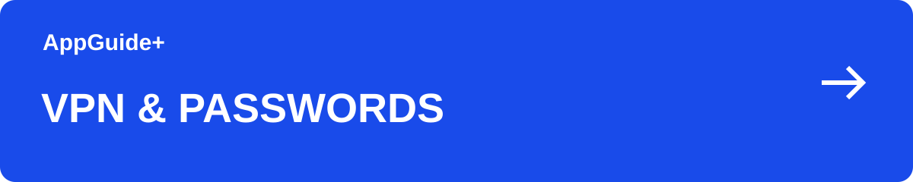

[이 분야의 안내](README.md) · [AppGuide+](https://github.com/appguideplus/app-guides#readme)

# Surfshark 요금제: Starter·One 선택과 기기 연결 안내

휴대폰과 컴퓨터 등 여러 기기에서 VPN이 필요하다면 동시 연결 조건부터 살펴보세요. 추가 보안 기능은 실제 사용할 것만 골라 비교하면 됩니다.

**[웹사이트에서 안내 보기 →](https://appguideplus.com/ko/surfshark/?utm_source=github)**

일부 웹 안내에는 제휴 링크가 포함됩니다. 해당 링크를 통한 구매·가입으로 운영자가 수수료를 받을 수 있습니다. AppGuide+는 독립 가이드입니다.

---

## VPN 외에 필요한 기능이 있나요?

| 상황 | 선택 | 확인할 내용 |
| --- | --- | --- |
| VPN을 중심으로 | Starter부터 확인 | VPN과 포함된 기본 기능을 기준으로 비교하세요. |
| 추가 보안 기능까지 | One · One+ 비교 | 추가 기능의 운영체제·지역 지원을 확인한 뒤 선택하세요. |

<strong>핵심 정보</strong>

## 핵심 정보

| 항목 | 내용 |
| --- | --- |
| 유료 VPN | 동시 연결 기기 수 무제한 |
| 플랜 | Starter · One · One+ |
| 무료 체험 | 동시 연결 3대 제한 안내 |

<strong>2026년 10월 21일 한국 요금표에서 확인한 가격</strong>

## 2026년 10월 21일 한국 요금표에서 확인한 가격

Starter와 One은 첫 27개월 선결제 70,200원(세전), 월 환산 2,600원으로 표시됐습니다. 매달 청구되는 금액이 아니며 부가세·추가 옵션은 결제 화면에서 확인하세요. 당시 세전 표준 갱신가는 Starter 연 104,833원, One 연 131,373원으로 달랐습니다.

[요금제 비교 후 제휴 링크로 시작하기](https://appguideplus.com/ko/surfshark/?utm_source=github)

제휴 안내: 연결된 웹 안내의 제휴 링크를 통한 구매에 따라 운영자가 수수료를 받을 수 있습니다.

<strong>기기 수와 결제 조건을 같이 보세요</strong>

## 기기 수와 결제 조건을 같이 보세요

유료 VPN은 동시 연결 기기 수 제한이 없다고 안내합니다. 무료 체험에는 별도 제한이 있으므로 체험 조건을 유료 구독과 구분하세요.

장기 상품의 월 환산 가격은 매달 청구되는 금액과 다를 수 있습니다. 결제 기간·첫 결제 총액·다음 갱신 조건을 한 화면에서 확인한 뒤 선택하세요.

<strong>이용 순서</strong>

## 이용 순서

1. 사용할 기기의 운영체제와 필요한 추가 기능을 확인합니다.
2. 플랜과 이용 기간을 선택하고 결제 총액·갱신 조건을 읽습니다.
3. 공식 앱을 설치한 뒤 가입한 계정으로 로그인합니다.

<strong>자주 묻는 질문</strong>

## 자주 묻는 질문

### NordVPN과 비교할 때 무엇부터 보나요?

동시에 연결할 기기 수, 필요한 기능, 이용 기간의 총비용부터 비교하세요. 실제 연결 품질은 사용하는 환경에서 확인해야 합니다.

### 체험과 유료 구독의 기기 조건이 같나요?

공식 요금 안내는 유료 VPN의 무제한 동시 연결과 무료 체험의 3대 제한을 구분합니다.

<strong>단계별 가이드</strong>

## 단계별 가이드

- [Surfshark Bypasser 설정: 특정 앱만 VPN에서 제외하기](surfshark-bypasser.ko.md)
- [Surfshark 첫 연결과 자동 연결 설정](surfshark-setup.ko.md)

<strong>함께 볼 안내</strong>

## 함께 볼 안내

- [NordVPN 요금제 선택: 결제 기간·갱신·기기 수 안내](nordvpn.ko.md)
- [Proton VPN 무료·Plus 비교: 기기 수와 서버 선택](proton-vpn.ko.md)
- [AdGuard 광고차단: 무료 확장 프로그램과 유료 앱 선택](https://github.com/appguideplus/adguard-guides/blob/main/adguard.ko.md)
- [Proton Pass 무료·Plus 비교: 비밀번호와 이메일 별칭 관리](proton-pass.ko.md)

<strong>출처와 확인일</strong>

## 출처와 확인일

- [플랜 구성과 기기 조건](https://surfshark.com/pricing)

내용 확인일: 2026-09-12. GitHub판 편집일: 2026-10-21. 가격 확인일: 2026-10-21.

AppGuide+가 작성한 독립적인 이용 안내이며, 각 서비스의 공식 고객지원 문서는 아닙니다.

---

[웹 안내로 이어가기](https://appguideplus.com/ko/surfshark/?utm_source=github) · [다른 안내 고르기](README.md)

읽기 구성 정리: 2026-10-23.
